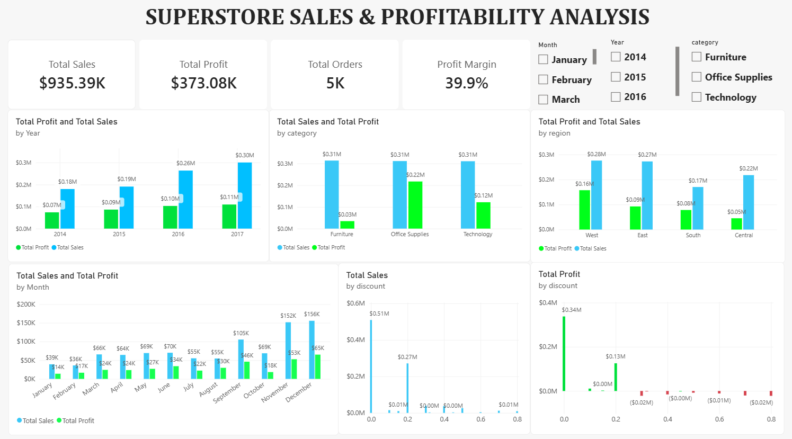

# Superstore Sales & Profitability Analysis

## Project Overview
This project analyzes retail sales and profitability data using MySQL and Power BI. The objective is to identify sales trends, evaluate product category and regional performance, and understand the relationship between discounts and profitability.

## Tools
- **MySQL:** Data querying and analysis using SQL
- **Power BI:** Data visualization and dashboard development

## Business Questions
- How do sales and profit change over time?
- Which product categories generate the highest sales and profit?
- Which regions perform best in terms of profitability?
- How do discounts affect profit and loss?
- How does profit margin change over time?

## Dashboard Preview

## Key Performance Indicators (KPIs)
| Metric | Result |
|---|---:|
| Total Sales | $935,390.97 |
| Total Profit | $373,081.04 |
| Total Orders | 5,009 |
| Profit Margin | 39.39% |

## Key Insights
- The dataset recorded total sales of **$935,390.97** and total profit of **$373,081.04**, with 5,009 orders and an overall profit margin of 39.39%.
- Furniture recorded the lowest profit margin at 10.99%, indicating lower profitability compared with the other product categories.
- The West region achieved the highest profit margin at 57.06%. Meanwhile, Central recorded the lowest margin at 20.76%, despite generating higher sales **$217,528.27** than South **$170,026.11**. South achieved a profit margin of 45.99% despite having the lowest sales.
- Transactions with discounts above 20% generated negative profits. Discounts of 21–50% resulted in a loss of **$48,767.21**, while discounts above 50% resulted in a loss of **$53,812.93**.
- The highest total profit was recorded in 2017, reaching **$109,542.22**, indicating that 2017 was the strongest year in terms of total profit.

## Recommendations
- Review Furniture product pricing, operational costs, and discount strategies to improve its relatively low profit margin.
- Investigate the factors contributing to Central's low profit margin despite its higher sales compared with South. Focus on improving cost efficiency and evaluating product performance in the region.
- Evaluate high-discount transactions, particularly discounts above 20%, to minimize losses and ensure promotional activities contribute to overall profitability.
- Analyze the West region's sales and profitability strategies to identify practices that could be applied to other regions.
- Examine the factors contributing to the highest profit in 2017 and use these findings to support future sales and business planning.

## Project Deliverables
- SQL-based data analysis
- Interactive Power BI dashboard
- Business insights and recommendations

## Conclusion
This project demonstrates the use of SQL for data analysis and Power BI for presenting business performance insights to support data-driven decision-making.
